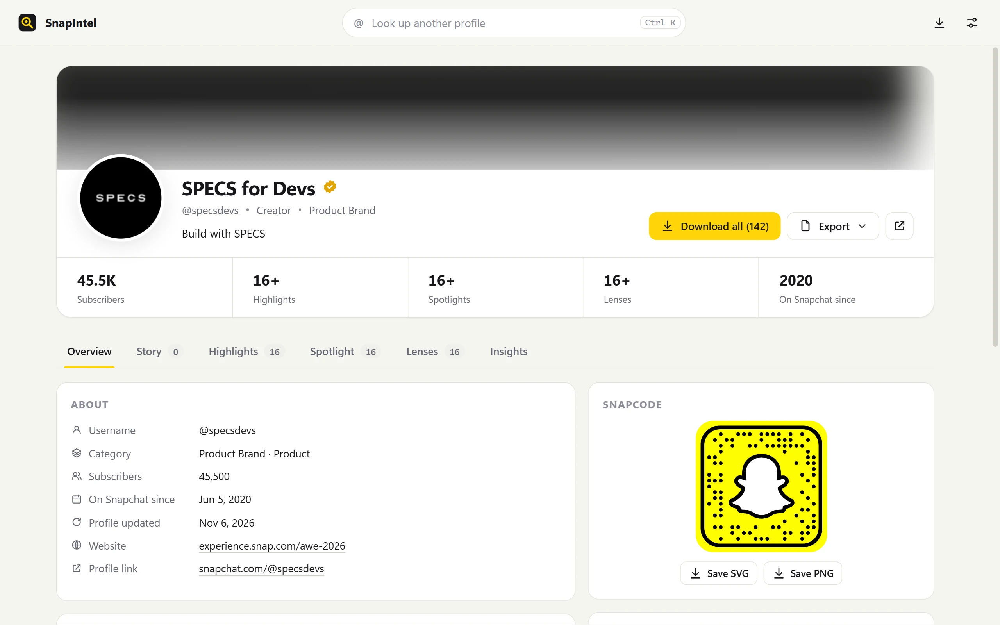
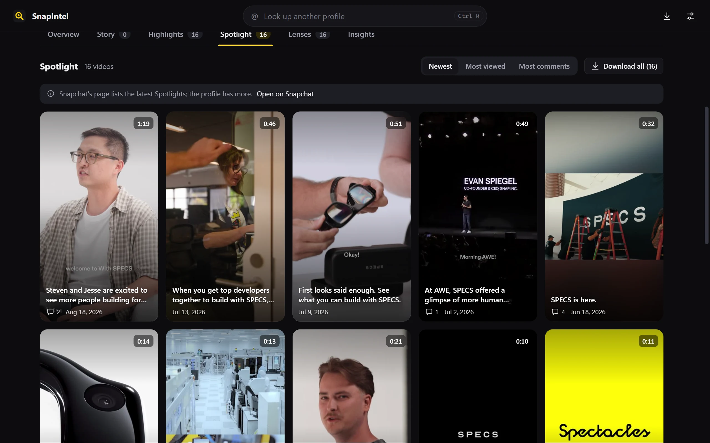
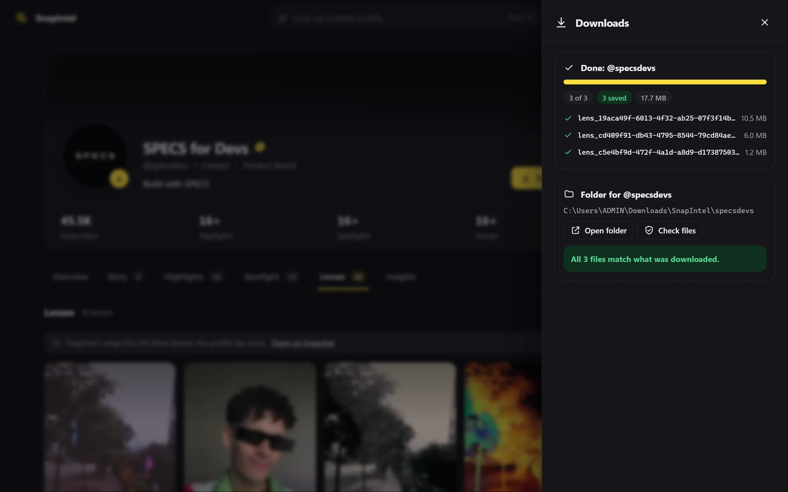
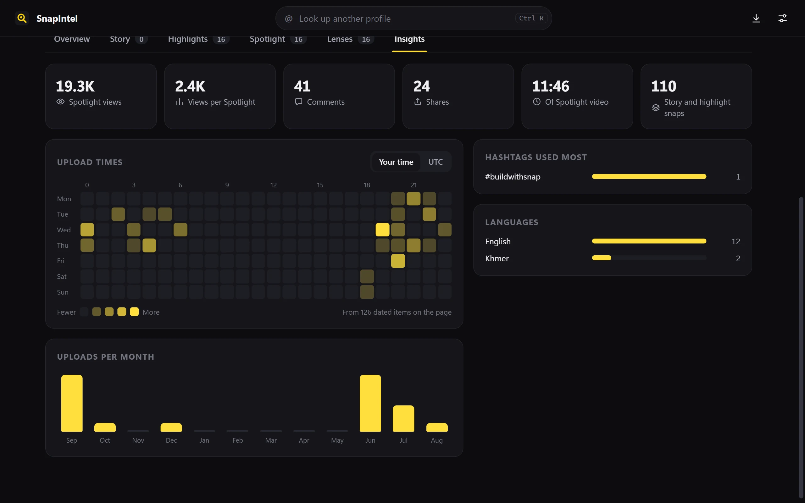
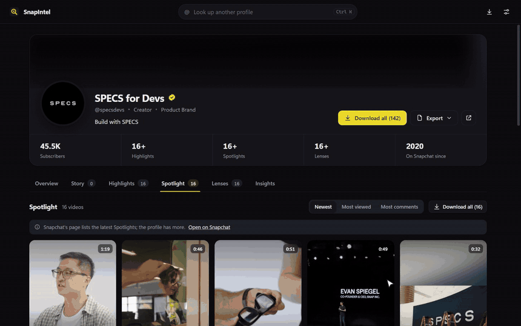
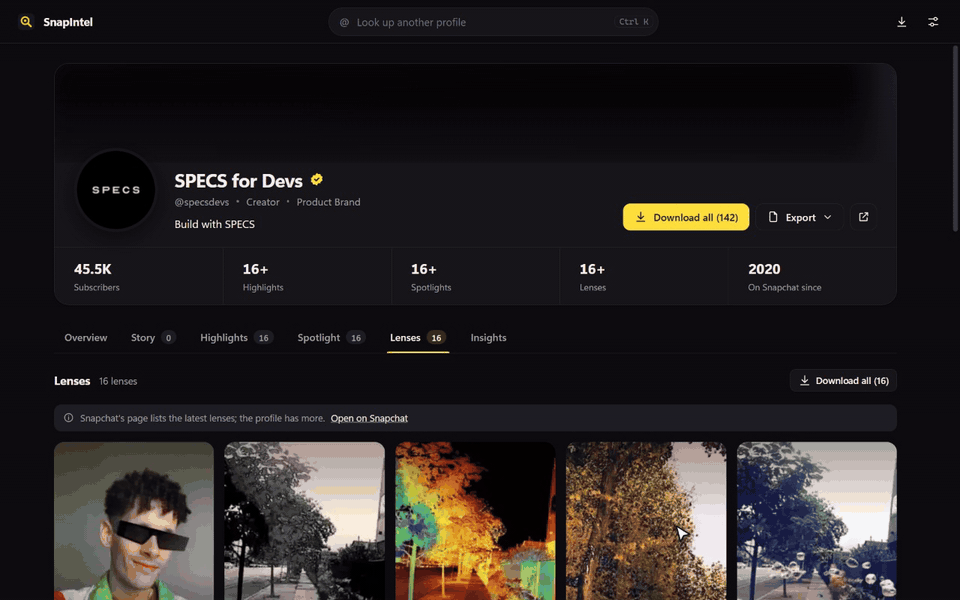

<div align="center">


# SnapIntel

**See what a public Snapchat profile shares, and keep a copy you can verify.**

A desktop app for Windows and Linux. No Snapchat account, no sign-in, no tracking:<br>
it reads the profile's public page on snapchat.com and nothing else.

[](https://github.com/ezzuldinSt/snapintel-app/releases/latest)
[](#install)
[](docs/development.md)
[](LICENSE)

**[Download](https://github.com/ezzuldinSt/snapintel-app/releases/latest)** &nbsp;·&nbsp; [User guide](docs/README.md) &nbsp;·&nbsp; [What's new](CHANGELOG.md) &nbsp;·&nbsp; [Command-line tool](cli/README.md)

<br>

<picture>
  <source media="(prefers-color-scheme: dark)" srcset="docs/media/profile-dark.webp">
  
</picture>

</div>

<br>

## Type a username, get the whole profile

Paste a profile link or type a username. A second later you have the profile's details, its story, highlights, Spotlight videos and lenses, each in its own tab.

<div align="center">

</div>

## What you get

<table>
<tr>
<td width="50%" valign="top">

### Everything in one place

Name, badge, category, subscriber count, bio, website, when the account was created and last updated, its Snapcode (save it as SVG or PNG), and the accounts Snapchat lists as related.

Story, highlights, Spotlight and lenses are grids you can open, play and step through with the arrow keys.

[How to read a profile →](docs/profiles.md)

</td>
<td width="50%"></td>
</tr>
<tr>
<td width="50%"></td>
<td width="50%" valign="top">

### A viewer that tells you about each video

For every Spotlight: views, comments, shares, boosts and recommends, date, length, sound, language and category, the text shown on the video, Snapchat's own AI title and summary, the phrases it expects people to search for, the top comments, and captions when Snapchat has transcribed it.

[The viewer in detail →](docs/viewer.md)

</td>
</tr>
<tr>
<td width="50%" valign="top">

### Downloads you can check later

Pick a few items or take everything. Each file is recorded with its source, upload date and SHA-256 in a manifest beside it. Run the same download again and it only fetches what is new; **Check files** re-hashes the folder and tells you if anything was changed or lost. Videos are saved without Snapchat's watermark.

[Downloading and verifying →](docs/downloads.md)

</td>
<td width="50%"></td>
</tr>
<tr>
<td width="50%"></td>
<td width="50%" valign="top">

### Insights and export

Totals, upload times by weekday and hour, uploads per month, the hashtags used most, what the videos are about and which languages they are in.

Export the whole profile as JSON, or as a CSV with one row per item for a spreadsheet.

[Insights and export →](docs/insights-and-export.md)

</td>
</tr>
</table>

### See it in motion

<table>
<tr>
<td width="50%" align="center"><br><sub>Open a Spotlight, read its details, load its captions</sub></td>
<td width="50%" align="center"><br><sub>Tick a few items, download, then check the files</sub></td>
</tr>
</table>

## Install

Get the installer for your system from the **[latest release](https://github.com/ezzuldinSt/snapintel-app/releases/latest)**.

| System | File | How |
|---|---|---|
| **Windows 10 / 11** | `SnapIntel_1.1.1_x64-setup.exe` | Run it. It installs for your user account only, with no administrator prompt. |
| **Debian, Ubuntu, Mint** | `SnapIntel_1.1.1_amd64.deb` | `sudo apt install ./SnapIntel_1.1.1_amd64.deb` |
| **Fedora, openSUSE** | `SnapIntel-1.1.1-1.x86_64.rpm` | `sudo dnf install ./SnapIntel-1.1.1-1.x86_64.rpm` |
| **Any other Linux** | `SnapIntel_1.1.1_amd64.AppImage` | `chmod +x SnapIntel_1.1.1_amd64.AppImage`, then run it. |

The installers are not code-signed, so Windows SmartScreen shows a warning the first time: choose **More info**, then **Run anyway**. Each release lists SHA-256 checksums so you can confirm your download.

More detail, including what Linux needs for video, is in [Getting started](docs/getting-started.md).

## Guides

| | |
|---|---|
| [Getting started](docs/getting-started.md) | Install it and look up your first profile. |
| [Reading a profile](docs/profiles.md) | What each tab shows, and what a profile that isn't public looks like. |
| [The viewer](docs/viewer.md) | Playing media, Spotlight details, comments, captions, keyboard shortcuts. |
| [Downloading and verifying](docs/downloads.md) | Selecting items, where files go, the manifest, checking a folder. |
| [Insights and export](docs/insights-and-export.md) | The charts, and the JSON and CSV files. |
| [Settings](docs/settings.md) | Download folder, language, theme, and the compatibility check. |
| [Privacy and limits](docs/privacy.md) | What SnapIntel reads, what it never reads, and what Snapchat doesn't publish. |
| [Troubleshooting](docs/troubleshooting.md) | Videos that don't play, empty profiles, and other problems. |
| [Development](docs/development.md) | Building from source, tests, how the code is organised, releasing. |

## Private by design

SnapIntel shows what a profile's owner chose to publish, and stops there.

- **No account and no sign-in.** It sees exactly what a signed-out visitor to snapchat.com sees.
- **It talks only to Snapchat.** No analytics, no update pings, no third-party servers.
- **No location data.** Snap coordinates and a profile's address are on Snapchat's page; SnapIntel never reads, stores or exports them, and a test enforces it.
- **No commenter identities.** Comments are read as words, date and counts. The names, IDs and avatars of the people who wrote them are never read.
- **No monitoring.** It does not watch profiles over time or alert you when an account posts.

Two things it can't show, because Snapchat doesn't publish them to signed-out visitors: more than the first page of each list, and the Snap Map. [Privacy and limits](docs/privacy.md) has the details.

## Prefer the terminal?

The original Python tool is here too, packaged as `snapintel`, with JSON output, the same verifiable downloads, a self-check and offline tests. See [`cli/`](cli/README.md).

```bash
pip install ./cli
snapintel -u <username> -l a --json
```

## Build from source

You need [Rust](https://rustup.rs) 1.77 or newer (on Linux also the WebKitGTK development packages, listed in [Development](docs/development.md)).

```bash
cd desktop
cargo run                # build and start the app
cargo test --workspace   # the offline tests
```

The interface is plain HTML, CSS and JavaScript built into the program: no Node.js step and no dev server.

## What's in this repository

```
desktop/          the app
  core/           library: reads Snapchat's page, downloads, exports, the compatibility check
  src-tauri/      the window, the commands the interface may call, settings
  ui/             the interface: HTML, CSS and JavaScript, no framework
cli/              the Python command-line tool and its tests
tests/fixtures/   page snapshots that both sets of tests run on, offline
docs/             the user guides and their pictures
```

## Credits and licence

SnapIntel began as [SnapIntel by Kr0wZ](https://github.com/Kr0wZ/SnapIntel), a Python command-line tool, which this repository is a fork of. The desktop app is a rewrite of it in Rust.

Licensed under the [GNU Affero General Public License v3.0](LICENSE).

SnapIntel is an independent project. It is not affiliated with, endorsed by or sponsored by Snap Inc. "Snapchat", "Spotlight", "Bitmoji" and "Snapcode" are trademarks of Snap Inc. The profile shown in the pictures is one of Snap's own public accounts; the comment text in them is sample text. Use SnapIntel lawfully and with respect for the people whose profiles you look at.
