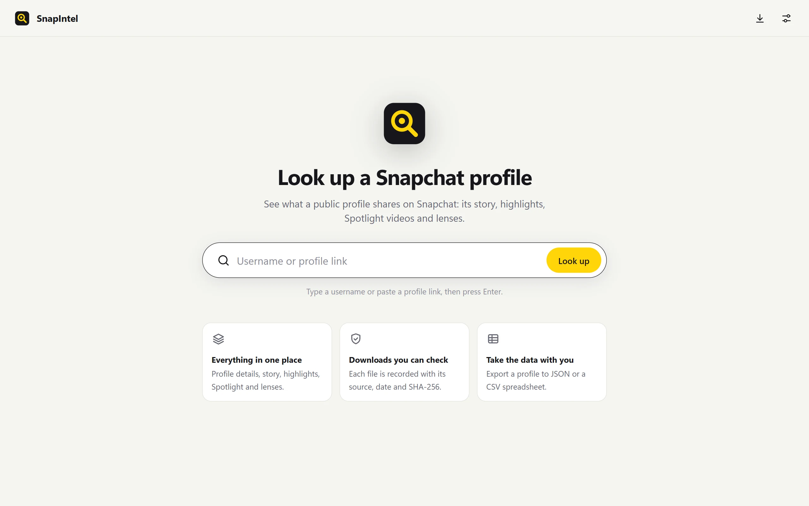

# SnapIntel user guide

SnapIntel is a desktop app that shows what a public Snapchat profile shares on snapchat.com and saves its media with a record you can verify later.

New here? Start with [Getting started](getting-started.md): it takes about two minutes.

| Guide | What it covers |
|---|---|
| [Getting started](getting-started.md) | Installing on Windows and Linux, your first lookup, updating and uninstalling. |
| [Reading a profile](profiles.md) | The Overview, Story, Highlights, Spotlight and Lenses tabs, and profiles that aren't public. |
| [The viewer](viewer.md) | Playing media, Spotlight details, top comments, captions, keyboard shortcuts. |
| [Downloading and verifying](downloads.md) | Selecting items, where files go, the manifest, repeating a download, checking a folder. |
| [Insights and export](insights-and-export.md) | The charts on the Insights tab, and the JSON and CSV exports. |
| [Settings](settings.md) | Every setting, and the check that tells you when Snapchat has changed its page. |
| [Privacy and limits](privacy.md) | What SnapIntel reads, what it never reads, and what Snapchat doesn't publish. |
| [Troubleshooting](troubleshooting.md) | Common problems and how to fix them. |
| [Development](development.md) | Building from source, tests, how the code is organised, making a release. |

The Python command-line tool has its own guide in [`cli/README.md`](../cli/README.md).

## The app at a glance

<picture>
  <source media="(prefers-color-scheme: dark)" srcset="media/home-dark.webp">
  
</picture>

- **The search box** takes a username (`nasa`), a handle (`@nasa`) or a profile link (`https://www.snapchat.com/add/nasa`). Press <kbd>Ctrl</kbd>+<kbd>K</kbd> anywhere to jump to it.
- **The download button** (top right) opens the Downloads panel: progress, results, and the check of saved files.
- **The sliders button** (top right) opens Settings.
- **The SnapIntel name** (top left) takes you back to the start screen, which lists the profiles you opened recently.
