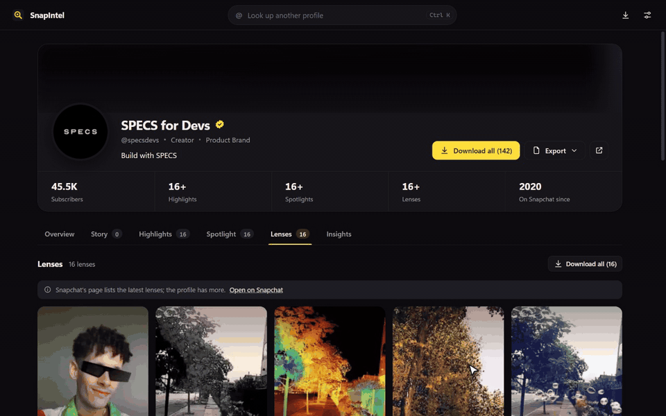
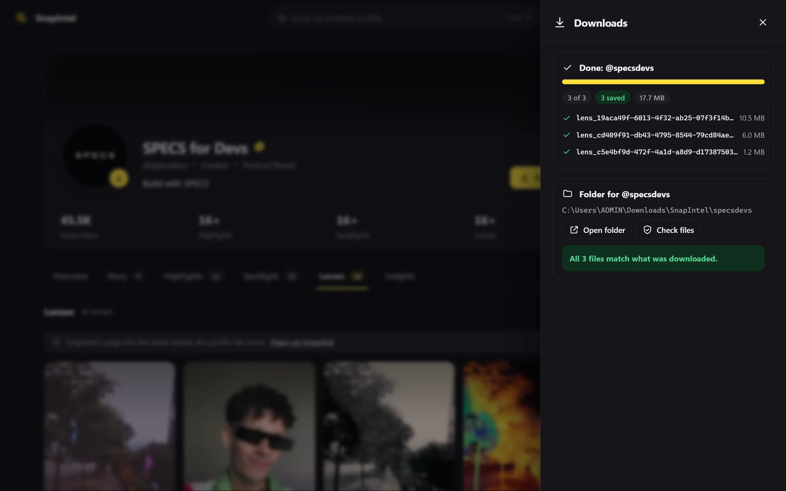

# Downloading and verifying

[← All guides](README.md)

SnapIntel saves media exactly as Snapchat serves it and keeps a record beside the files, so that later you can show where each file came from and that it hasn't changed.



## Choosing what to save

| To save | Do this |
|---|---|
| Everything the profile's page lists | **Download all** in the profile's header |
| One tab's items | **Download all** at the top of that tab |
| A few items | Tick the circle in the corner of each, then **Download** in the bar at the bottom |
| All the snaps of one highlight | Tick the highlight's card |
| The item you are viewing | **Download** in the viewer |

**Clear** in the selection bar, or <kbd>Esc</kbd>, drops the selection. Ticks stay as you move between tabs, so you can gather items from several.

## Watching it happen

The **Downloads** panel opens when a download of several files starts, and the download button at the top right reopens it at any time. It shows the progress, each file as it lands with its size, and a **Stop** button. A single file saved from the viewer finishes with a short message and a **Show** button that opens its folder.

Only one download runs at a time; start another when it finishes.

## Where files go

```
Downloads/
  SnapIntel/
    <username>/
      story_<id>.mp4
      highlight_<id>.jpg
      spotlight_<id>.mp4
      lens_<id>.mp4
      snapintel-manifest.json
```

- Each profile gets its own folder. Turn that off, or choose another place, in [Settings](settings.md).
- A file's name is its kind and Snapchat's media ID, so the same item always gets the same name.
- A file's "modified" date is set to when it was **uploaded to Snapchat**, where Snapchat gives that date. Sort the folder by date and it reads as a timeline.
- **Open folder** in the Downloads panel shows the folder in your file manager.

## The record: `snapintel-manifest.json`

For every file the manifest stores:

- the address it was downloaded from,
- when it was downloaded,
- its size and its **SHA-256** hash,
- what it is (story, highlight, Spotlight, lens, Bitmoji),
- and its upload date, when Snapchat gives one.

It is a plain JSON file you can read, archive with the media, or hand to someone else along with them.

## Downloading again

Run the same download later and SnapIntel only fetches what is new. Files it already saved are skipped and counted as **already saved**.

A saved file that no longer matches its recorded hash is **never overwritten**. SnapIntel leaves it alone, saves the fresh copy beside it, and tells you which files had changed.

A stopped or failed download can simply be started again: finished files are kept and unfinished ones are fetched from the start.

## Check files

**Check files** in the Downloads panel re-hashes every file in the folder and compares it with the manifest:



- **All files match** means every file is byte-for-byte what was downloaded.
- **Changed** lists files whose contents differ from the record.
- **Missing** lists files in the record that are no longer in the folder.
- Media files that are in the folder but not in the record are counted separately.

## Working with the command-line tool

The [command-line tool](../cli/README.md) writes the same manifest. A folder started by one can be continued by the other, and `snapintel --verify <folder>` runs the same check from a terminal.
