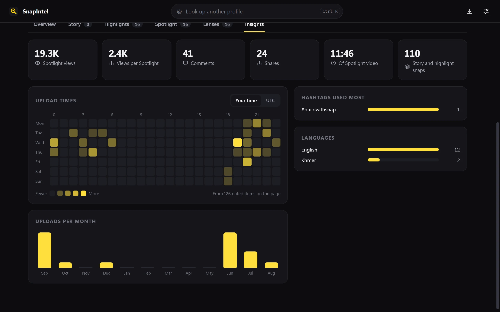
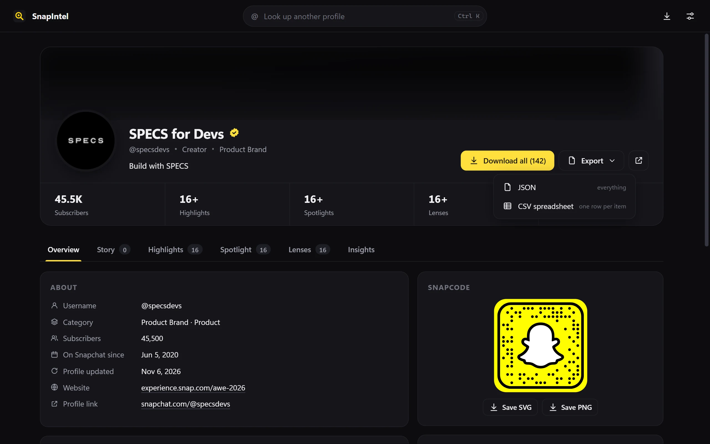

# Insights and export

[← All guides](README.md)

## Insights

The **Insights** tab summarises everything on the profile's page.

| Part | What it shows |
|---|---|
| **Totals** | Spotlight views, average views per Spotlight, comments, shares, the total length of Spotlight video, and the number of story and highlight snaps. A figure is left out when Snapchat hides it for this profile. |
| **Upload times** | A heat map of weekday against hour: the brighter a square, the more was uploaded then. Switch between **Your time** and **UTC**. Hover a square for its count. |
| **Uploads per month** | The last twelve months. |
| **Hashtags used most** | How many Spotlights use each hashtag. |
| **What the videos are about** | The categories Snapchat files the Spotlights under. |
| **Languages** | The language Snapchat detects in each Spotlight. |

Keep in mind what the numbers are drawn from: the items on the profile's page, which for a busy profile is its **most recent** highlights and Spotlights rather than its whole history. The line under the heat map says how many dated items it counted.

## Export

**Export** in the profile's header writes what you are looking at to a file.

### JSON: everything

One document with the whole report: the profile, the story, highlights with their snaps, Spotlights with every detail and their top comments, lenses, related accounts, and the totals. It is made for scripts and for archiving:

- counts and durations are numbers,
- dates are ISO 8601 in UTC (`2026-06-16T20:14:00Z`),
- anything Snapchat leaves out or hides is `null`.

### CSV: one row per item

A spreadsheet with a row for each story snap, highlight snap, Spotlight and lens. It opens directly in Excel, LibreOffice or Google Sheets, with Arabic and other scripts intact.

| Column | Meaning |
|---|---|
| `section` | `story`, `highlight`, `spotlight` or `lens` |
| `group` | The highlight's title, or the lens's creator |
| `title` | The Spotlight's caption, or the lens's name |
| `id` | Snapchat's media ID (it also names the downloaded file) |
| `type` | `image` or `video` |
| `uploaded_at` | Upload date, ISO 8601 in UTC |
| `duration_seconds`, `views`, `comments`, `shares` | Spotlight figures |
| `hashtags` | The Spotlight's hashtags, separated by spaces |
| `language` | The language Snapchat detects in the Spotlight |
| `on_screen_text` | The text shown on the Spotlight video |
| `url` | Where the media file is |
| `page_url` | The item's page on snapchat.com |

### What is never in an export

Location data, and the names, IDs and avatars of people who commented. SnapIntel doesn't read them, so there is nothing to export. See [Privacy and limits](privacy.md).

## The Snapcode

The **Snapcode** card on the Overview tab saves the profile's code as **SVG** (sharp at any size, good for print) or **PNG**.
