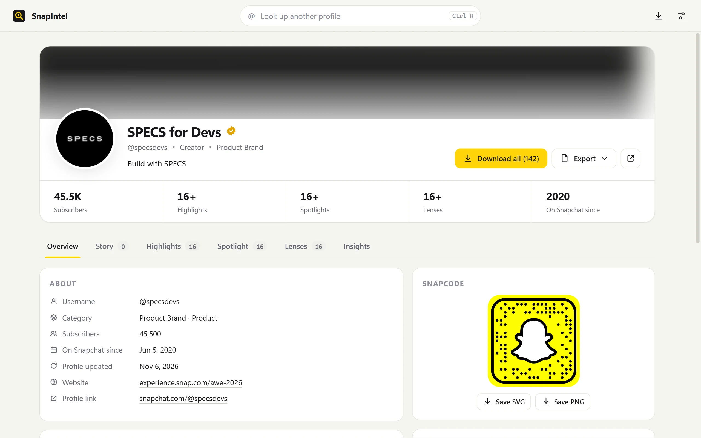
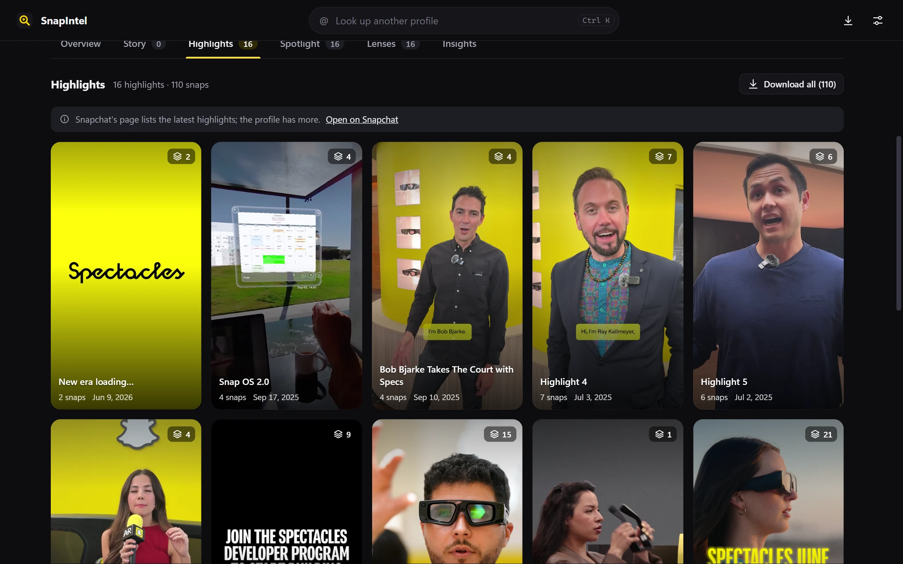
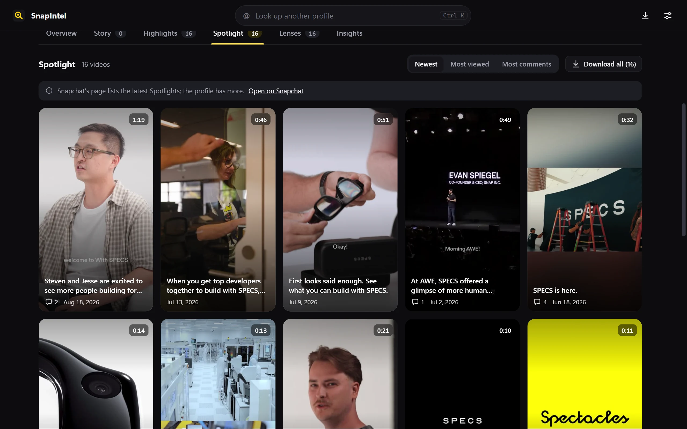
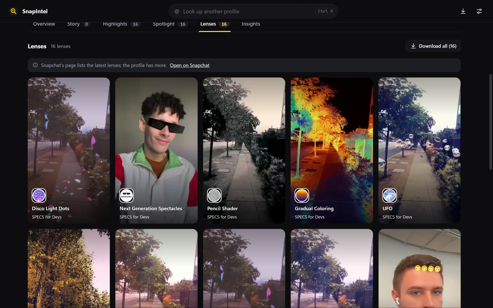
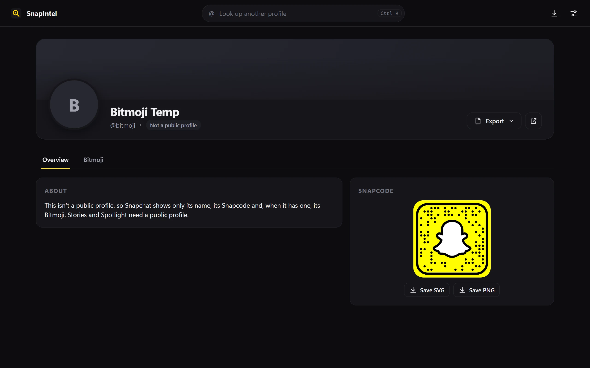

# Reading a profile

[← All guides](README.md)

A profile opens with a header and a row of tabs. The header holds the name, the badge (creator or public figure), the category, the bio, and the headline numbers: subscribers, how many snaps are in the story right now, highlights, Spotlights, lenses, and the year the account joined Snapchat.

<picture>
  <source media="(prefers-color-scheme: dark)" srcset="media/profile-dark.webp">
  
</picture>

A number followed by `+`, such as **16+**, means Snapchat's page lists the newest 16 and the profile has more. See [what Snapchat doesn't publish](privacy.md#what-snapchat-doesnt-publish).

The buttons in the header:

- **Download all** saves everything the profile's page lists. See [Downloading and verifying](downloads.md).
- **Export** writes the profile as JSON or CSV. See [Insights and export](insights-and-export.md).
- **The arrow** opens the profile on snapchat.com in your browser.

## Overview

- **About:** username, category, subscribers, when the account was created and last updated, website, the profile's address on snapchat.com, and under **Also on** the other sites the profile says are the same person or organisation. Text can be selected and copied.
- **Snapcode:** the profile's code, which you can save as SVG (sharp at any size) or PNG.
- **Latest highlights** and **Most viewed Spotlights:** shortcuts into those tabs.
- **Related accounts:** the accounts Snapchat suggests beside this one. Click one to look it up.

## Story

The snaps in the profile's story now, in order. A story disappears from Snapchat after 24 hours, so this tab is often empty. Open a snap and it plays through the story like Snapchat does, with a segment bar at the top.

## Highlights

Each card is one highlight: a collection of snaps the profile keeps on show. The badge is the number of snaps in it. Open a card to play through them; tick it to select all of its snaps for download.

## Spotlight

The profile's Spotlight videos, with their length, and their views and comments where Snapchat shows them. Sort by **Newest**, **Most viewed** or **Most comments**. Opening a video shows everything Snapchat publishes about it: see [The viewer](viewer.md).

## Lenses

The lenses the profile made. Each opens a preview video, and **Open in Snapchat** unlocks the lens in the Snapchat app.

## Insights

Totals and charts drawn from everything on the page. See [Insights and export](insights-and-export.md).

## Profiles that aren't public

Most personal accounts are not public profiles. Snapchat shows only their name, their Snapcode and, when they have one, their 3D Bitmoji. SnapIntel shows the same and says so.

The **Bitmoji** tab shows the current Bitmoji. **Find earlier looks** checks the earlier versions of it that Snapchat keeps online and lists the distinct ones, newest first.
