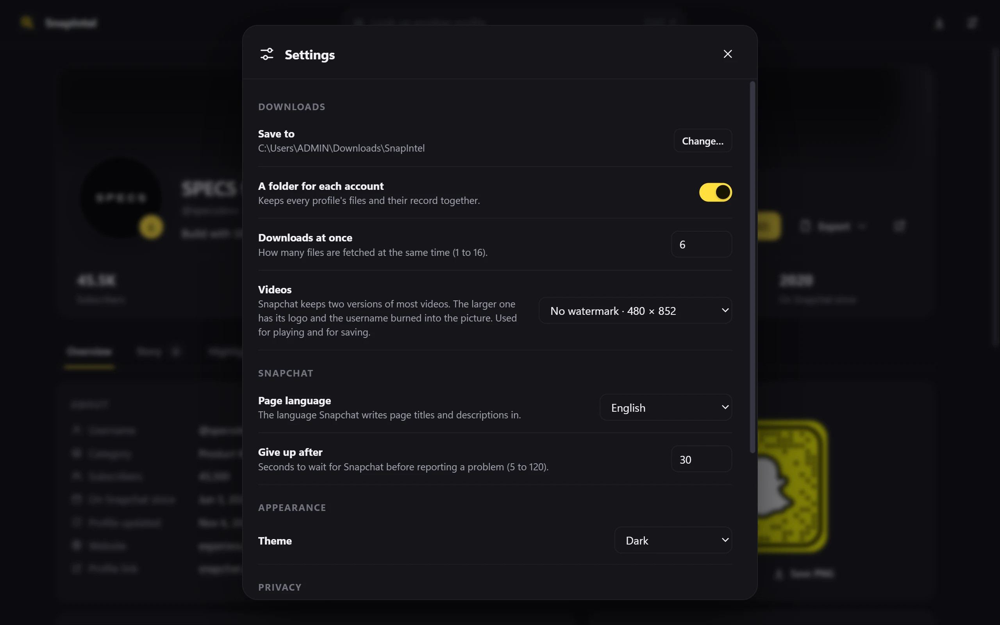
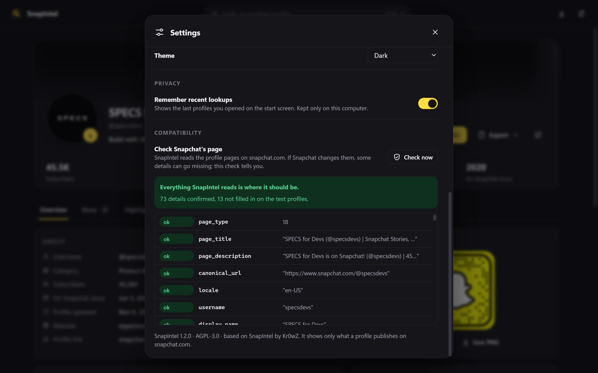

# Settings

[← All guides](README.md)

Open Settings with the sliders button at the top right. Changes take effect at once.

## Downloads

| Setting | What it does | Default |
|---|---|---|
| **Save to** | The folder downloads go into. **Change…** picks another. | `Downloads/SnapIntel` |
| **A folder for each account** | Keeps every profile's files, and their record, in a subfolder named after the username. | On |
| **Downloads at once** | How many files are fetched at the same time, from 1 to 16. Lower it on a slow or unreliable connection. | 6 |

## Snapchat

| Setting | What it does | Default |
|---|---|---|
| **Page language** | The language Snapchat writes page titles, categories and descriptions in. **Let Snapchat choose** leaves it to Snapchat; the others are English, العربية, Français, Deutsch, Español, Português, Italiano, Türkçe, हिन्दी and 日本語. | English |
| **Give up after** | How many seconds to wait for Snapchat before reporting a problem, from 5 to 120. | 30 |

## Appearance

**Theme:** match the system, light, or dark.

## Privacy

**Remember recent lookups** keeps the last profiles you opened on the start screen, so you can reopen them with a click. The list is kept only on this computer. Turn the setting off and the list is erased; **Clear** on the start screen empties it without turning it off.

## Compatibility: is Snapchat's page still the same?

SnapIntel reads the profile pages on snapchat.com. When Snapchat changes those pages, details can go missing without any error. **Check now** tells you whether that has happened.

The check loads two of Snap's own profiles and looks for every detail SnapIntel reads. Each one is listed with a status:

| Status | Meaning |
|---|---|
| **ok** | Found, with a sample of the value. |
| **empty** | The page has the place for it, but the test profiles have nothing there. This is normal: for example, they may have no story today. |
| **skipped** | Not applicable to that kind of profile. |
| **missing** | Snapchat's page no longer has it where SnapIntel looks. The check shows where the trail stops and what is there instead. |

If anything is **missing**, look for a newer release of SnapIntel, or [report it](https://github.com/ezzuldinSt/snapintel-app/issues) with the list the check produced.

## Where settings are stored

| System | File |
|---|---|
| Windows | `%APPDATA%\app.snapintel.desktop\settings.json` |
| Linux | `~/.config/app.snapintel.desktop/settings.json` |

Delete the file to return to the defaults.
