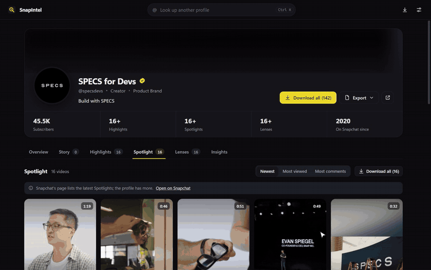
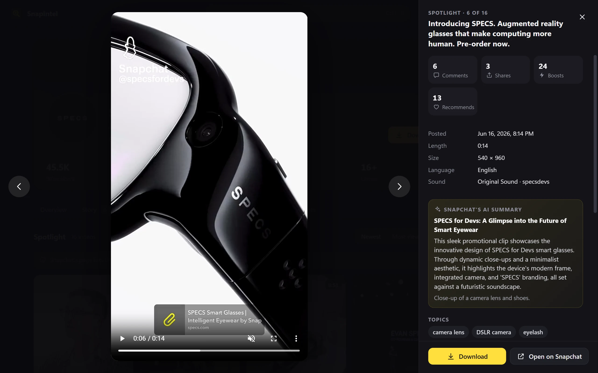
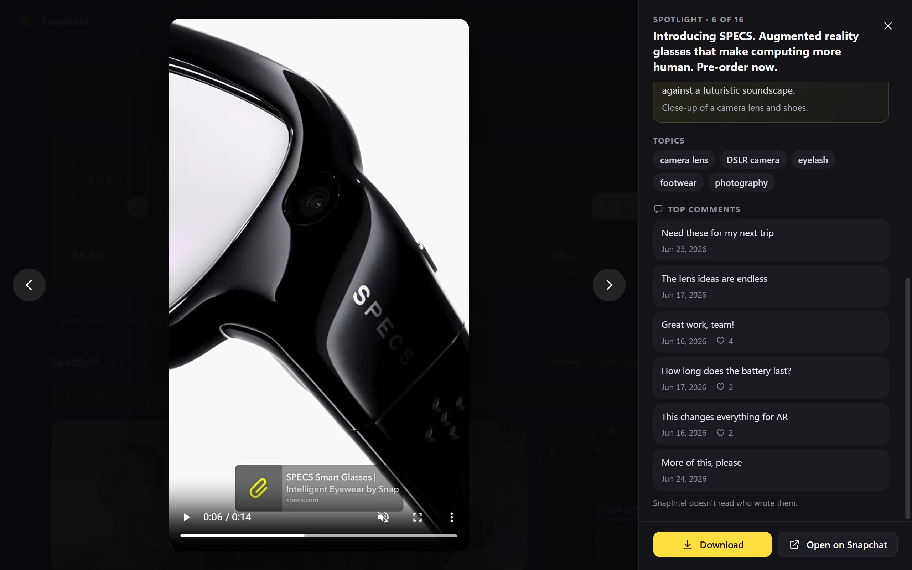

# The viewer

[← All guides](README.md)

Click any snap, highlight, Spotlight or lens and it opens in the viewer: the media on the left, everything known about it on the right.

## Moving around

| Do this | With the mouse | With the keyboard |
|---|---|---|
| Next or previous item | The arrows beside the media | <kbd>→</kbd> and <kbd>←</kbd> |
| Play or pause a video | The player's controls | <kbd>Space</kbd> |
| Close the viewer | The **✕** at the top right | <kbd>Esc</kbd> |

A story or a highlight plays through like it does on Snapchat: when one video ends the next starts, and the bar at the top shows where you are.

**Download** saves the item you are looking at. **Open on Snapchat** opens its page on snapchat.com (for a lens, **Open in Snapchat** unlocks it in the app).

If a video can't be played, the viewer says so and offers to open it in your browser. On Linux this usually means a missing video codec: see [Troubleshooting](troubleshooting.md).

## What a Spotlight tells you

Snapchat's page carries a lot about each Spotlight video. SnapIntel shows all of it, and leaves out anything Snapchat didn't provide for that video:

| Section | What it is |
|---|---|
| **Figures** | Views, comments, shares, boosts and recommends. Hover a figure for the exact number. Snapchat hides some of these on some videos. |
| **Posted, Length, Size** | Upload date and time in your time zone, duration, and the dimensions of the video being played. Which version plays is set under **Videos** in [Settings](settings.md). |
| **Language** | The language Snapchat detects in the video. |
| **Category** | The categories Snapchat files the video under. |
| **Sound** | The title and artist of the sound used. |
| **Text on the video** | The text overlaid on the video itself, when it differs from the caption. |
| **Hashtags** | The hashtags in the caption. |
| **Snapchat's AI summary** | A title and summary Snapchat generates for the video, and a one-line description of what it shows. These are Snapchat's words, not SnapIntel's, and they are sometimes wrong. |
| **Topics** | The keywords Snapchat attaches to the video. |
| **People search for** | The phrases Snapchat expects people to type to find it. |
| **Top comments** | See below. |
| **Captions** | See below. |

## Top comments

Snapchat's page includes a video's top few comments, not all of them; the note under the list says how many of the total you are seeing. Each comment shows its words, its date, and how many reactions and replies it has.

**SnapIntel never reads who wrote a comment.** The commenter's name, ID and avatar are on Snapchat's page, and SnapIntel skips them: they are not shown, not stored, and not in any export. The comment text in the pictures on this page is sample text.

## Captions

When Snapchat has transcribed a video, a **Show captions** button appears at the bottom of the details. It loads the transcript as a list of timed lines:

- Click a line to jump the video to that moment.
- The line being spoken is highlighted as the video plays.
- **Copy** puts the whole transcript on the clipboard.

## Stories, highlights and lenses

Snaps from a story or highlight show when they were posted, whether they are a photo or a video, and their position in the sequence. Lenses show who made them, when they were last updated, and whether they are an official Snapchat lens or a community one.
